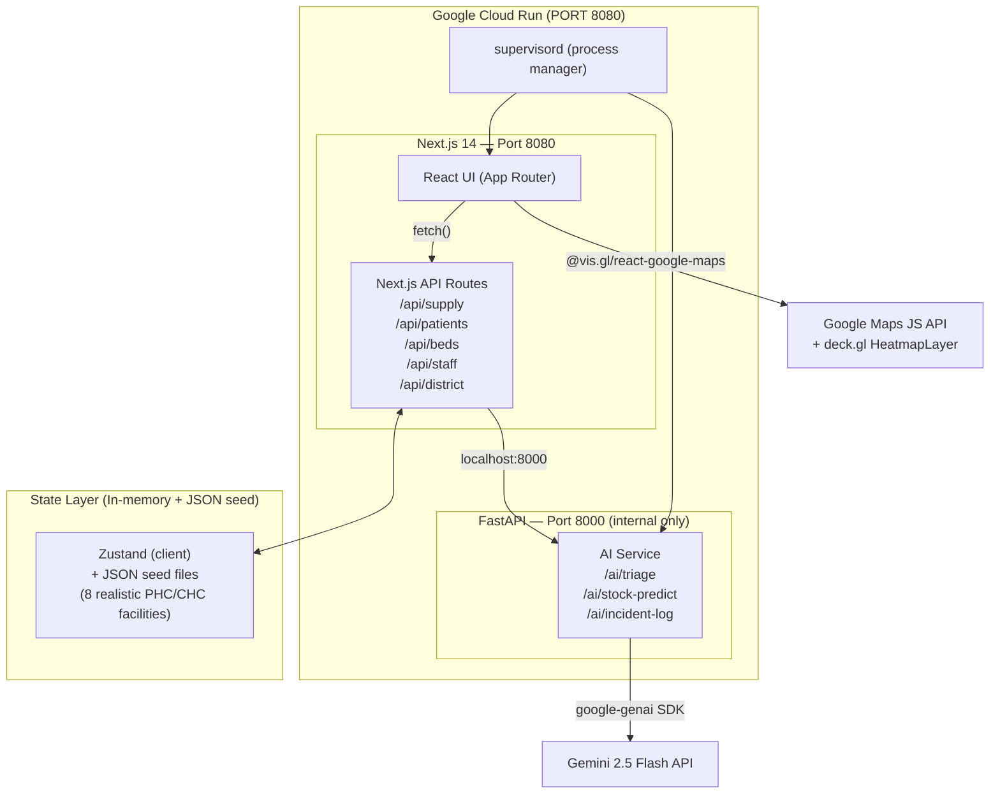

# Smart Health — AI-Driven Health Center & Supply Chain Management
## Implementation Blueprint

> Production-grade containerized solution for the PromptWars challenge.
> **Status: AWAITING APPROVAL — no files have been created yet.**

---

## 1. Architecture Overview

### System Design Philosophy

The system is a **full-stack monorepo** deployed as a **single Cloud Run container** listening on `PORT 8080`. A Next.js 14 App Router frontend serves both the UI and lightweight API routes. A FastAPI micro-service (running as a co-process managed by `supervisord`) handles all CPU-intensive AI tasks (Gemini calls, burn-rate calculations). Inter-process communication happens over `localhost:8000`.



---

## 2. Tech Stack Decision Matrix

| Layer | Technology | Rationale |
|---|---|---|
| **Frontend Framework** | Next.js 14 (App Router) | Server components, file-based routing, built-in a11y linter, `output: standalone` for minimal Docker image |
| **Styling** | Tailwind CSS v3 + shadcn/ui | Utility-first, accessible primitives (Radix UI), dark mode out-of-box |
| **Icons** | Lucide React | Lightweight, accessible SVGs with native `aria-label` support |
| **Client State** | Zustand | Minimal boilerplate, SSR-safe, supports devtools |
| **Charts** | Recharts | Accessible SVG charts with ARIA table fallbacks |
| **Maps** | `@vis.gl/react-google-maps` + `deck.gl` | Google's official React wrapper; HeatmapLayer via deck.gl (native `google.maps.visualization.HeatmapLayer` is **deprecated**) |
| **AI Backend** | FastAPI (Python 3.11) + `google-genai` SDK | Pydantic schemas, async endpoints, structured Gemini output |
| **Process Mgr** | Supervisord | Single container, two processes (Next.js + FastAPI) on Cloud Run |
| **Container** | Multi-stage Dockerfile (Node 20 + Python 3.11 slim) | ~350 MB final image |
| **Testing (Frontend)** | Jest + React Testing Library + Playwright (E2E) | Unit + integration + E2E coverage |
| **Testing (Backend)** | Pytest + pytest-asyncio + httpx | FastAPI endpoint and business logic tests |
| **Linting / Types** | TypeScript strict, ESLint (`jsx-a11y`), Ruff (Python) | Competition code quality requirement |
| **Env Management** | `.env.local` / Docker `--env-file` / Cloud Run secrets | No secrets in image |

---

## 3. Seed Data Design — 8 Realistic Facilities

```typescript
// Six PHCs + Two CHCs across two districts of Maharashtra, India
const FACILITIES = [
  { id: "phc-wardha-01", name: "PHC Sindi", type: "PHC", district: "Wardha",
    lat: 20.7002, lng: 78.6293, beds: { icu: 0, general: 12, oxygen: 4 } },
  { id: "phc-wardha-02", name: "PHC Arvi",  type: "PHC", district: "Wardha",
    lat: 20.9935, lng: 78.2306, beds: { icu: 0, general: 10, oxygen: 3 } },
  { id: "phc-wardha-03", name: "PHC Hinganghat", type: "PHC", district: "Wardha",
    lat: 20.5519, lng: 78.8368, beds: { icu: 0, general: 15, oxygen: 6 } },
  { id: "chc-wardha-01", name: "CHC Wardha Central", type: "CHC", district: "Wardha",
    lat: 20.7453, lng: 78.6022, beds: { icu: 6, general: 40, oxygen: 15 } },
  { id: "phc-yavatmal-01", name: "PHC Ner", type: "PHC", district: "Yavatmal",
    lat: 20.1806, lng: 78.1200, beds: { icu: 0, general: 12, oxygen: 4 } },
  { id: "phc-yavatmal-02", name: "PHC Pusad", type: "PHC", district: "Yavatmal",
    lat: 19.9098, lng: 77.5762, beds: { icu: 0, general: 10, oxygen: 5 } },
  { id: "phc-yavatmal-03", name: "PHC Wani",  type: "PHC", district: "Yavatmal",
    lat: 20.0527, lng: 78.9541, beds: { icu: 0, general: 14, oxygen: 5 } },
  { id: "chc-yavatmal-01", name: "CHC Yavatmal Urban", type: "CHC", district: "Yavatmal",
    lat: 20.3893, lng: 78.1320, beds: { icu: 8, general: 50, oxygen: 20 } },
]
```

Each facility seed includes realistic medicine stock (ORS, paracetamol, amoxicillin, metformin, insulin, oxytocin, etc.), a duty roster for the current week, and randomized patient queue data.

---

## 4. Feature Module Specifications

### Module A — Supply Chain Management

**Problem:** Frequent stock-outs, no predictive visibility.

| Feature | Implementation |
|---|---|
| **Inventory Dashboard** | Table of all medicines per facility with color-coded status (OK / Low / Critical) |
| **Burn-Rate Calculator** | `burnRate = (initialStock - currentStock) / daysSinceRefill` — pure function, unit-tested |
| **Days-to-Stockout (DTS)** | `dts = currentStock / burnRate` — triggers alert when `dts < 7` days |
| **AI Stock Prediction** | Gemini 2.5 Flash call with structured output: `{ medicine, predictedDTS, confidence, recommendation }` |
| **Reorder Recommendation** | Auto-generated order form with quantities, routed to district supply depot |
| **Supply Transfer Map** | Google Maps showing transfer routes between facilities via deck.gl `PathLayer` |

**Gemini Prompt Pattern (structured output):**
```python
class StockPrediction(BaseModel):
    medicine: str
    current_stock: int
    predicted_days_to_stockout: float
    confidence: Literal["high", "medium", "low"]
    recommendation: str
    order_quantity: int

response = client.models.generate_content(
    model="gemini-2.5-flash",
    contents=f"Analyze stock for {facility_name}: {stock_data_json}. "
             "Predict depletion risk and recommend reorder quantity.",
    config=GenerateContentConfig(
        response_mime_type="application/json",
        response_schema=list[StockPrediction],
    ),
)
```

---

### Module B — Patient Flow & Triage

**Problem:** Chaotic queues, no priority system, unpredictable wait times.

| Feature | Implementation |
|---|---|
| **Token Generation** | Sequential token number + timestamp, stored in Zustand |
| **AI Urgency Triage** | Gemini classifies symptoms into `P1/P2/P3/P4` (Emergency/Urgent/Semi-urgent/Non-urgent) |
| **Wait-Time Prediction** | `estimatedWait = avgServiceTime × (tokensAhead + weightedUrgency)` |
| **Queue Display** | Live-updating list with `aria-live="polite"` for screen reader announcements |
| **Triage Chatbot** | `<dialog>` modal with step-by-step symptom collection, keyboard-trappable focus |

**AI Triage structured output:**
```python
class TriageResult(BaseModel):
    token: str
    priority: Literal["P1", "P2", "P3", "P4"]
    urgency_label: str        # "Emergency", "Urgent", etc.
    chief_complaint: str
    recommended_action: str
    estimated_wait_minutes: int
```

---

### Module C — Bed & Resource Allocation

**Problem:** No real-time visibility into bed status.

| Feature | Implementation |
|---|---|
| **Bed Occupancy Grid** | Visual grid of beds (ICU / General / Oxygen) — color-coded with `aria-label` per cell |
| **Real-time Status Toggle** | Click to toggle Occupied/Available/Maintenance with optimistic UI update |
| **Occupancy Rate KPIs** | `occupancyRate = occupiedBeds / totalBeds` — displayed as progress bar with `role="meter"` |
| **Alert Thresholds** | `aria-live="assertive"` notification when ICU occupancy > 80% |
| **Cross-facility Availability** | Comparison table across all 8 facilities |

---

### Module D — Doctor & Staff Roster

**Problem:** Manual attendance with no district-level visibility.

| Feature | Implementation |
|---|---|
| **Weekly Duty Roster** | Grid calendar view (Mon–Sun per staff member) |
| **Real-time Presence Log** | Staff check-in/check-out with timestamp — toggled via button |
| **Absence Alert** | Auto-flag if expected staff not checked in by `shiftStart + 30min` |
| **AI Incident Logger** | Gemini generates structured incident report for unannounced absences |
| **Attendance Heatmap** | Per-facility attendance rate displayed on district map |

---

### Module E — District Command Center

**Problem:** No unified cross-facility visibility for district health officers.

| Feature | Implementation |
|---|---|
| **Unified Map Dashboard** | Google Maps with facility markers, color-coded by alert severity |
| **Heatmap Overlay** | deck.gl `HeatmapLayer` showing patient footfall intensity by geo-area |
| **Comparative Metrics Table** | Side-by-side KPIs (stock health %, bed occupancy %, attendance %) for all 8 facilities |
| **AI Incident Summary** | Gemini generates a district-wide daily briefing in natural language |
| **Alert Feed** | Real-time chronological log of cross-facility events with `aria-live` |

---

## 5. Complete Annotated File Tree

```
smart-health/                          # Monorepo root
├── Dockerfile                         # Multi-stage: Node 20 + Python 3.11
├── supervisord.conf                   # Process manager config (Next.js + FastAPI)
├── docker-compose.yml                 # Local dev (mounts .env.local)
├── .env.local.example                 # Template for required env vars
├── .gitignore
│
├── frontend/                          # Next.js 14 App Router
│   ├── package.json
│   ├── tsconfig.json                  # strict mode
│   ├── next.config.ts                 # output: 'standalone', images unoptimized
│   ├── tailwind.config.ts
│   ├── postcss.config.js
│   ├── eslint.config.mjs              # jsx-a11y + next plugin
│   ├── jest.config.ts
│   ├── playwright.config.ts
│   │
│   ├── public/
│   │   └── icons/                     # SVG favicons
│   │
│   ├── src/
│   │   ├── app/                       # App Router pages
│   │   │   ├── layout.tsx             # Root layout: skip-link, landmark regions
│   │   │   ├── page.tsx               # Landing / district selector
│   │   │   ├── globals.css
│   │   │   │
│   │   │   ├── supply/
│   │   │   │   ├── page.tsx           # Module A — Supply Chain
│   │   │   │   └── [facilityId]/
│   │   │   │       └── page.tsx       # Per-facility inventory detail
│   │   │   │
│   │   │   ├── patients/
│   │   │   │   ├── page.tsx           # Module B — Patient Flow
│   │   │   │   └── triage/
│   │   │   │       └── page.tsx       # AI Triage chatbot
│   │   │   │
│   │   │   ├── beds/
│   │   │   │   └── page.tsx           # Module C — Bed Tracker
│   │   │   │
│   │   │   ├── staff/
│   │   │   │   └── page.tsx           # Module D — Staff Roster
│   │   │   │
│   │   │   ├── district/
│   │   │   │   └── page.tsx           # Module E — Command Center
│   │   │   │
│   │   │   └── api/                   # Next.js API Routes (proxy to FastAPI)
│   │   │       ├── supply/route.ts
│   │   │       ├── patients/route.ts
│   │   │       ├── beds/route.ts
│   │   │       ├── staff/route.ts
│   │   │       ├── district/route.ts
│   │   │       └── ai/
│   │   │           ├── triage/route.ts
│   │   │           ├── stock-predict/route.ts
│   │   │           └── incident/route.ts
│   │   │
│   │   ├── components/
│   │   │   ├── ui/                    # shadcn/ui primitives
│   │   │   │   ├── button.tsx
│   │   │   │   ├── badge.tsx
│   │   │   │   ├── card.tsx
│   │   │   │   ├── dialog.tsx         # ARIA focus-trapped modal
│   │   │   │   ├── table.tsx
│   │   │   │   ├── tabs.tsx           # WAI-ARIA tablist pattern
│   │   │   │   └── progress.tsx       # role="meter" for occupancy
│   │   │   │
│   │   │   ├── layout/
│   │   │   │   ├── Sidebar.tsx        # nav landmark, keyboard-navigable
│   │   │   │   ├── Header.tsx         # banner landmark
│   │   │   │   └── SkipLink.tsx       # WCAG 2.4.1 bypass blocks
│   │   │   │
│   │   │   ├── supply/
│   │   │   │   ├── InventoryTable.tsx
│   │   │   │   ├── BurnRateCard.tsx
│   │   │   │   ├── StockAlertBanner.tsx   # aria-live="assertive"
│   │   │   │   └── ReorderModal.tsx
│   │   │   │
│   │   │   ├── patients/
│   │   │   │   ├── TokenCard.tsx
│   │   │   │   ├── QueueList.tsx          # aria-live="polite"
│   │   │   │   ├── TriageModal.tsx
│   │   │   │   └── WaitTimeBadge.tsx
│   │   │   │
│   │   │   ├── beds/
│   │   │   │   ├── BedGrid.tsx            # aria-label per bed cell
│   │   │   │   ├── OccupancyMeter.tsx     # role="meter"
│   │   │   │   └── BedStatusToggle.tsx
│   │   │   │
│   │   │   ├── staff/
│   │   │   │   ├── RosterCalendar.tsx
│   │   │   │   ├── AttendanceRow.tsx
│   │   │   │   └── AbsenceAlertBanner.tsx # aria-live="assertive"
│   │   │   │
│   │   │   ├── district/
│   │   │   │   ├── FacilityMap.tsx        # vis.gl + deck.gl HeatmapLayer
│   │   │   │   ├── MetricsComparisonTable.tsx
│   │   │   │   ├── AlertFeed.tsx          # aria-live="polite"
│   │   │   │   └── AIBriefingCard.tsx
│   │   │   │
│   │   │   └── shared/
│   │   │       ├── KPICard.tsx
│   │   │       ├── SeverityBadge.tsx      # never color-only, includes text
│   │   │       └── LoadingSpinner.tsx     # aria-label="Loading..."
│   │   │
│   │   ├── hooks/
│   │   │   ├── useSupply.ts
│   │   │   ├── usePatients.ts
│   │   │   ├── useBeds.ts
│   │   │   ├── useStaff.ts
│   │   │   └── useDistrict.ts
│   │   │
│   │   ├── store/
│   │   │   ├── supplyStore.ts             # Zustand slice
│   │   │   ├── patientStore.ts
│   │   │   ├── bedStore.ts
│   │   │   ├── staffStore.ts
│   │   │   └── facilityStore.ts
│   │   │
│   │   ├── lib/
│   │   │   ├── burnRate.ts                # Pure functions (unit-tested)
│   │   │   ├── triage.ts                  # Wait-time calculation logic
│   │   │   ├── attendance.ts              # Absence detection logic
│   │   │   └── apiClient.ts               # Typed fetch wrapper
│   │   │
│   │   ├── types/
│   │   │   ├── facility.ts
│   │   │   ├── supply.ts
│   │   │   ├── patient.ts
│   │   │   ├── bed.ts
│   │   │   └── staff.ts
│   │   │
│   │   └── data/
│   │       └── seed.ts                    # 8-facility seed dataset
│   │
│   └── tests/
│       ├── unit/
│       │   ├── burnRate.test.ts           # Pure function tests
│       │   ├── triage.test.ts
│       │   └── attendance.test.ts
│       ├── integration/
│       │   ├── supply-api.test.ts         # Next.js route handler tests
│       │   └── beds-api.test.ts
│       └── e2e/
│           ├── supply-flow.spec.ts        # Playwright
│           └── triage-flow.spec.ts
│
└── backend/                               # FastAPI AI Service
    ├── requirements.txt
    ├── main.py                            # FastAPI app, PORT 8000
    ├── routers/
    │   ├── triage.py                      # POST /ai/triage
    │   ├── stock.py                       # POST /ai/stock-predict
    │   └── incident.py                    # POST /ai/incident-log
    ├── schemas/
    │   ├── triage.py                      # Pydantic models
    │   ├── stock.py
    │   └── incident.py
    ├── services/
    │   ├── gemini_client.py               # google-genai SDK wrapper
    │   └── validators.py                  # Input sanitisation
    └── tests/
        ├── test_triage.py                 # pytest unit tests
        ├── test_stock.py
        └── test_burn_rate.py
```

---

## 6. Docker & Cloud Run Configuration

### Multi-Stage Dockerfile Strategy

```dockerfile
# ─── Stage 1: Python Dependencies ────────────────────────────────────────────
FROM python:3.11-slim AS python-deps
WORKDIR /app/backend
COPY backend/requirements.txt .
RUN pip install --user --no-cache-dir -r requirements.txt

# ─── Stage 2: Node.js Builder ─────────────────────────────────────────────────
FROM node:20-alpine AS node-builder
WORKDIR /app/frontend
COPY frontend/package*.json ./
RUN npm ci
COPY frontend/ .
ENV NEXT_TELEMETRY_DISABLED=1
RUN npm run build    # Produces .next/standalone

# ─── Stage 3: Production Runtime ──────────────────────────────────────────────
FROM python:3.11-slim AS runner

# Install Node.js 20 into the Python slim image
RUN apt-get update && apt-get install -y --no-install-recommends \
    nodejs npm supervisor curl \
    && rm -rf /var/lib/apt/lists/*

ENV PORT=8080
ENV PYTHONDONTWRITEBYTECODE=1
ENV PYTHONUNBUFFERED=1
ENV HOSTNAME="0.0.0.0"
ENV NEXT_TELEMETRY_DISABLED=1

WORKDIR /app

# Copy Python packages
COPY --from=python-deps /root/.local /root/.local
ENV PATH=/root/.local/bin:$PATH

# Copy backend source
COPY backend/ ./backend/

# Copy Next.js standalone build
COPY --from=node-builder /app/frontend/.next/standalone ./frontend/
COPY --from=node-builder /app/frontend/.next/static ./frontend/.next/static
COPY --from=node-builder /app/frontend/public ./frontend/public

# Supervisord config
COPY supervisord.conf /etc/supervisor/conf.d/supervisord.conf

EXPOSE 8080

# Health check for Cloud Run
HEALTHCHECK --interval=30s --timeout=10s --start-period=15s \
  CMD curl -f http://localhost:8080/api/health || exit 1

CMD ["/usr/bin/supervisord", "-c", "/etc/supervisor/conf.d/supervisord.conf"]
```

### `supervisord.conf`

```ini
[supervisord]
nodaemon=true
logfile=/var/log/supervisor/supervisord.log

[program:nextjs]
command=node /app/frontend/server.js
environment=PORT=8080,HOSTNAME=0.0.0.0
autorestart=true
stdout_logfile=/dev/stdout
stdout_logfile_maxbytes=0
stderr_logfile=/dev/stderr
stderr_logfile_maxbytes=0

[program:fastapi]
command=python -m uvicorn backend.main:app --host 0.0.0.0 --port 8000
directory=/app
autorestart=true
stdout_logfile=/dev/stdout
stdout_logfile_maxbytes=0
stderr_logfile=/dev/stderr
stderr_logfile_maxbytes=0
```

### Required Environment Variables

```bash
# .env.local.example
GEMINI_API_KEY=your_gemini_api_key_here
NEXT_PUBLIC_GOOGLE_MAPS_API_KEY=your_maps_api_key_here
NEXT_PUBLIC_GOOGLE_MAPS_MAP_ID=your_map_id_here       # Required for vector maps + deck.gl
FASTAPI_INTERNAL_URL=http://localhost:8000             # Internal only — NOT public
NEXT_PUBLIC_APP_URL=http://localhost:8080
```

---

## 7. Testing Strategy

### Frontend Unit Tests (Jest + RTL)

```typescript
// tests/unit/burnRate.test.ts
describe('calculateBurnRate()', () => {
  it('returns correct rate for standard depletion', () => {
    expect(calculateBurnRate(100, 70, 15)).toBeCloseTo(2.0)   // 2 units/day
  })
  it('returns Infinity when daysSinceRefill is 0', () => {
    expect(calculateBurnRate(100, 70, 0)).toBe(Infinity)
  })
  it('handles zero depletion gracefully', () => {
    expect(calculateBurnRate(100, 100, 10)).toBe(0)
  })
})

describe('calculateDaysToStockout()', () => {
  it('returns correct DTS for non-zero burn rate', () => {
    expect(calculateDaysToStockout(60, 2)).toBe(30)
  })
  it('returns Infinity when burnRate is 0', () => {
    expect(calculateDaysToStockout(60, 0)).toBe(Infinity)
  })
})
```

```typescript
// tests/unit/triage.test.ts
describe('calculateEstimatedWait()', () => {
  it('P1 patients skip queue', () => {
    expect(calculateEstimatedWait('P1', 10, 5)).toBe(0)
  })
  it('P3 wait is proportional to queue depth', () => {
    const wait = calculateEstimatedWait('P3', 5, 5)
    expect(wait).toBeGreaterThan(20)
  })
})
```

### Backend Tests (Pytest)

```python
# backend/tests/test_burn_rate.py
from backend.services.validators import calculate_burn_rate, days_to_stockout

def test_burn_rate_standard():
    assert calculate_burn_rate(initial=100, current=70, days=15) == pytest.approx(2.0)

def test_days_to_stockout_finite():
    assert days_to_stockout(stock=60, burn_rate=2.0) == 30.0

def test_days_to_stockout_zero_burn():
    assert days_to_stockout(stock=60, burn_rate=0) == float("inf")
```

```python
# backend/tests/test_triage.py  (FastAPI test client)
from httpx import AsyncClient
from backend.main import app

async def test_triage_endpoint_returns_priority():
    async with AsyncClient(app=app, base_url="http://test") as client:
        resp = await client.post("/ai/triage", json={
            "token": "T001", "symptoms": "chest pain, shortness of breath",
            "age": 62, "facility_id": "chc-wardha-01"
        })
    assert resp.status_code == 200
    data = resp.json()
    assert data["priority"] in ["P1", "P2", "P3", "P4"]
    assert "estimated_wait_minutes" in data
```

### E2E Tests (Playwright)

```typescript
// tests/e2e/supply-flow.spec.ts
test('supply module: stock alert shown for critical item', async ({ page }) => {
  await page.goto('/supply/phc-wardha-01')
  await expect(page.getByRole('alert')).toContainText('Critical')
  // Keyboard accessible: Tab to reorder button, press Enter
  await page.keyboard.press('Tab')
  await page.keyboard.press('Enter')
  await expect(page.getByRole('dialog')).toBeVisible()
})
```

### Test Run Commands

```bash
# Frontend
cd frontend && npm test                    # Jest unit + integration
cd frontend && npx playwright test        # Playwright E2E

# Backend
cd backend && pytest --cov=. --cov-report=term-missing

# Lint
cd frontend && npm run lint               # ESLint + jsx-a11y
cd backend  && ruff check . && mypy .
```

---

## 8. Security Strategy

| Concern | Mitigation |
|---|---|
| **API Key exposure** | `GEMINI_API_KEY` server-only; Maps key restricted by HTTP referrer in GCP console |
| **Input validation** | Pydantic schemas on all FastAPI endpoints; Zod schemas on Next.js API routes |
| **CSRF** | Next.js built-in `same-origin` protection on API routes |
| **Rate limiting** | FastAPI `slowapi` middleware: 30 req/min on `/ai/*` endpoints |
| **Error leakage** | FastAPI exception handlers return generic messages in production |
| **Dependency scanning** | `npm audit` + `pip-audit` in Dockerfile build stage |
| **Non-root container** | Supervisord runs as `www-data` (uid 33) in production stage |

---

## 9. Accessibility Strategy (WCAG 2.1 AA)

| Criterion | Implementation |
|---|---|
| **1.1.1 Non-text Content** | All Lucide icons have `aria-label` or `aria-hidden` + adjacent text |
| **1.3.1 Info and Relationships** | Semantic `<header>`, `<nav>`, `<main>`, `<aside>`, `<section>` landmarks |
| **1.4.3 Contrast** | Tailwind palette tuned for ≥4.5:1 text, ≥3:1 UI components |
| **1.4.11 Non-text Contrast** | Status badges include text label — never color alone |
| **2.1.1 Keyboard** | All interactive elements reachable by Tab; dialogs trap focus with `focus-trap-react` |
| **2.4.1 Bypass Blocks** | `<SkipLink>` component renders `href="#main-content"` at page top |
| **2.4.3 Focus Order** | Logical DOM order matches visual order; no `tabIndex > 0` |
| **4.1.2 Name, Role, Value** | Bed grid cells: `role="gridcell"`, `aria-label="Bed 3 — ICU — Occupied"` |
| **4.1.3 Status Messages** | Queue updates: `aria-live="polite"`; ICU alerts: `aria-live="assertive"` |
| **Roving tabindex** | Tab panels, bed grid use WAI-ARIA roving tabindex keyboard pattern |

---

## 10. Sequential Build Order

> Each phase is a discrete, atomic set of tasks in Antigravity.

### Phase 0 — Scaffolding & Infrastructure (Day 1 AM)
1. Create monorepo root (`smart-health/`)
2. Bootstrap Next.js 14 with TypeScript strict + Tailwind + shadcn/ui
3. Set up FastAPI backend with Pydantic and `google-genai`
4. Write `Dockerfile`, `supervisord.conf`, `docker-compose.yml`
5. Configure ESLint (jsx-a11y), Jest, Playwright, Ruff, mypy
6. Create `.env.local.example`

### Phase 1 — Seed Data & Core Types (Day 1 PM)
7. Define all TypeScript types (`facility.ts`, `supply.ts`, `patient.ts`, `bed.ts`, `staff.ts`)
8. Create 8-facility seed dataset with realistic medicine stocks, rosters, queue data
9. Set up Zustand stores for all 5 modules
10. Implement `lib/burnRate.ts`, `lib/triage.ts`, `lib/attendance.ts` pure functions
11. Write unit tests for all pure functions (target: 100% branch coverage)

### Phase 2 — Layout & Design System (Day 1 PM)
12. Build `RootLayout` with skip link, landmark regions, dark-mode tokens
13. Build `Sidebar` (keyboard-navigable, `aria-current` on active link)
14. Build shared components: `KPICard`, `SeverityBadge`, `LoadingSpinner`
15. Configure Tailwind high-contrast color palette

### Phase 3 — Module A: Supply Chain (Day 2 AM)
16. FastAPI `POST /ai/stock-predict` with Gemini structured output
17. Next.js API route `/api/supply` (proxy + input validation)
18. `InventoryTable`, `BurnRateCard`, `StockAlertBanner` components
19. `ReorderModal` (accessible `<dialog>` with focus trap)
20. Supply module integration test

### Phase 4 — Module B: Patient Flow (Day 2 AM)
21. FastAPI `POST /ai/triage` with Gemini structured output
22. Next.js API route `/api/patients`
23. `TokenCard`, `QueueList` (aria-live), `TriageModal` components
24. `WaitTimeBadge` + wait-time estimation hook
25. Patient flow integration test + triage unit tests

### Phase 5 — Module C: Beds (Day 2 PM)
26. `BedGrid` with `role="grid"`, `aria-label` per cell, `role="meter"` occupancy bar
27. `BedStatusToggle` with optimistic UI
28. `OccupancyMeter` with `aria-valuenow`/`aria-valuemax`
29. Beds API route + integration test

### Phase 6 — Module D: Staff Roster (Day 2 PM)
30. `RosterCalendar` (week view)
31. `AttendanceRow` with check-in/check-out toggle
32. `AbsenceAlertBanner` (aria-live="assertive")
33. FastAPI `POST /ai/incident-log` for absence reporting
34. Staff API route + integration test

### Phase 7 — Module E: District Command Center (Day 3 AM)
35. `FacilityMap` using `@vis.gl/react-google-maps` + deck.gl `HeatmapLayer` + `ScatterplotLayer`
36. `MetricsComparisonTable` (sortable, scoped `<th>` headers)
37. `AlertFeed` (aria-live)
38. `AIBriefingCard` — Gemini district summary
39. District API route

### Phase 8 — E2E Tests & Polish (Day 3 PM)
40. Playwright E2E: supply flow, triage flow
41. Accessibility audit: run `axe-core` scan via Playwright `@axe-core/playwright`
42. Performance: add `loading.tsx` suspense boundaries, lazy-load map
43. Final Docker build + `docker run -p 8080:8080` smoke test

---

## 11. Open Questions

> [!IMPORTANT]
> **Q1: Single container vs. two Cloud Run services?**
> The plan above uses a **single container** (supervisord) to satisfy the "runs inside one Docker container" constraint. If you prefer two separate Cloud Run services (Next.js + FastAPI independently), the Dockerfile splits into two and Next.js API routes proxy to the FastAPI Cloud Run URL via env var. **Please confirm your preference.**

> [!IMPORTANT]
> **Q2: Gemini model — 2.5 Flash vs. 2.0 Flash?**
> `gemini-2.5-flash` is recommended (supports structured output with `response_schema`, 1M context, thinking budget). If you have API tier constraints, we can use `gemini-2.0-flash` as a fallback. **Please confirm.**

> [!WARNING]
> **Q3: Google Maps API Key — do you have one?**
> The district map requires a valid `NEXT_PUBLIC_GOOGLE_MAPS_API_KEY` with Maps JavaScript API enabled and a Map ID (for vector maps + deck.gl). If not available, we will implement a **mock map** using a styled SVG district overlay as a graceful fallback so the container still runs without the key.

> [!NOTE]
> **Q4: Real-time updates — polling vs. WebSocket?**
> The plan uses **short-polling** (every 15 seconds via `setInterval`) for simplicity and Cloud Run compatibility (no sticky sessions needed). WebSockets can be added later. Confirm if this is acceptable.

> [!NOTE]
> **Q5: Authentication?**
> The competition scope appears to be a demo/prototype. The plan does **not** include auth (NextAuth, Clerk, etc.) to maximize feature breadth. If district-level vs. PHC-level role separation is required, please specify.
